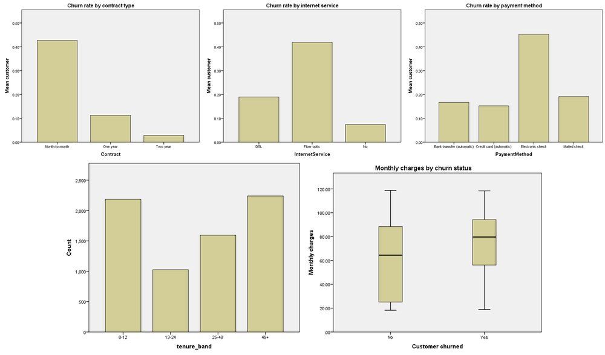

# Telco Customer Churn Analysis

**Tool:** SPSS

SPSS analysis of 7,043 customers from the IBM Telco churn dataset. Cleans the data, recodes churn and tenure bands, then charts what separates customers who leave from those who stay.

## Highlights
- Month-to-month contracts churn at 42.7%, against 2.8% on two-year contracts
- Fiber optic customers churn at 41.9%, DSL at 19.0%, no-internet at 7.4%
- Electronic check payers churn at 45.3%, other payment methods at 15-19%
- 2,186 customers (31%) are in their first year

## Files
- `churn_rate_portfolio.doc`
- `churn_rate_output.spv`

The write-up is `churn_rate_portfolio.doc` and the SPSS output is `churn_rate_output.spv`. The IBM Telco dataset itself is not included; it is publicly available.

## How to open
Open the `.spv` in IBM SPSS Statistics (or the free SPSS Viewer) to see the output. The `.doc` opens in Word.

---
By Faaz Mistry · [LinkedIn](https://www.linkedin.com/in/faaz-mistry-369a11246/) · faazmistry110@gmail.com
